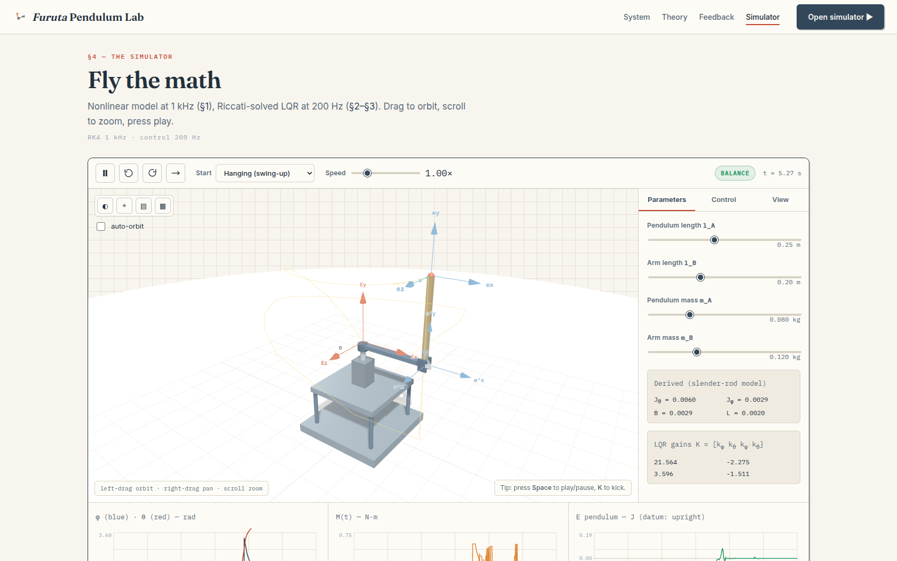

# Furuta Pendulum Lab

An offline-capable interactive simulator and theory write-up for a rotary self-balancing
inverted (Furuta) pendulum, with an **LQR** balance controller and energy-based swing-up.



## Pages

Five static pages, no build step:

| Page | What it does |
|---|---|
| `index.html` | Landing page with a live 3D figure of the rig |
| `system.html` | The rig, its bases and parameters, and the equations of motion |
| `control.html` | The theory paper (`theory/main.pdf`) with a distillation underneath |
| `simulator.html` | 3D viewport, RK4 @ 1 kHz, controller @ 200 Hz, live LQR gains, swing-up → balance, charts, kicks, sensor noise |
| `feedback.html` | Form that composes an email in the visitor's mail client |

Each page loads only the JavaScript it needs; `js/physics.js` and `js/main.js` load everywhere.
Navbar and footer markup is copied per page, so changes mean editing each one.

The paper source is `theory/main.tex`; the built `theory/main.pdf` is committed and is what the
theory page serves. There is no CI — run `bash theory/build.sh` after editing the source and commit
the regenerated PDF, or the site keeps showing the old version.

## Run it locally

No server required — it works offline, straight from the file:

```bash
git clone https://github.com/ptjuatja/furuta.git
cd furuta
xdg-open index.html      # or just double-click it
```

Or serve it: `python3 -m http.server 8000` → http://localhost:8000

three.js, OrbitControls, KaTeX and all fonts are vendored in `lib/`.

## Editing

- **Content** lives in the page for that section.
- **Colours, fonts and spacing** are the CSS variables at the top of `css/style.css`; a page's position on the blueprint ramp is its `<body data-page="…">` attribute.
- **Simulator defaults** (gains, torque limit, pump mode) are the `params`/`ctrl` blocks at the top of `js/simulator.js`; slider ranges are in `simulator.html`.
- **SVG diagrams** are generated in `js/main.js`, not written in the HTML.
- **Feedback address** is `CONTACT.to` at the top of `js/feedback.js`; set `CONTACT.endpoint` to POST to a form service instead of using `mailto:`.

## Simulator controls

- **Play** — start near-upright (balance) or hanging (watch swing-up catch it).
- **Kick** — disturb the pendulum and watch LQR recover. (`Space` play/pause, `K` kick, `R` reset.)
- **Parameters** — change lengths/masses; LQR gains recompute live.
- **Control** — tune LQR weights `Q`/`R`, swing-up pump, torque limit, capture zone, sensor noise.
- **View** — toggle bases, angle arcs, vectors, trail, grid; snap the camera to preset angles.

## Sign conventions

With the convention of `theory/main.tex` (`φ = 0` upright), positive `M(t)` spins the arm
counterclockwise viewed from above; the swing-up law is `M = −k_E·E·sgn(φ̇·cosφ)`; balance torque
opposes the lean, `M = −Kx` with `x = [φ, θ, φ̇, θ̇]`. Verify motor wiring against this before
applying power.

## Tests

```bash
node test/physics.test.js          # EoMs vs Lagrange, energy, LQR, swing-up, noise

cd test/e2e && npm install         # headless Chrome via puppeteer-core
node site.test.js                  # page loads, nav, simulator interaction
node visual.test.js                # fonts, rendering, camera
node stress.test.js                # long runs, noise, extreme parameters
```

Start a server first (`python3 -m http.server 8123`) and point the suites at it. They accept
`SITE_URL` (default `http://127.0.0.1:8123/`), `CHROME` (default `/usr/bin/google-chrome`) and
`SHOTS` (default `shots`). `npm test` runs `site.test.js` and `visual.test.js` only.

## Credits

Built as a teaching prototype — three.js for the 3D scene, KaTeX for the math. Dynamics notation
after Prof. Robert G. Parker's *Essential Dynamics* (2026) handout.
